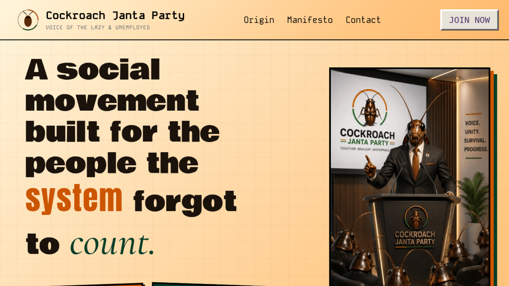
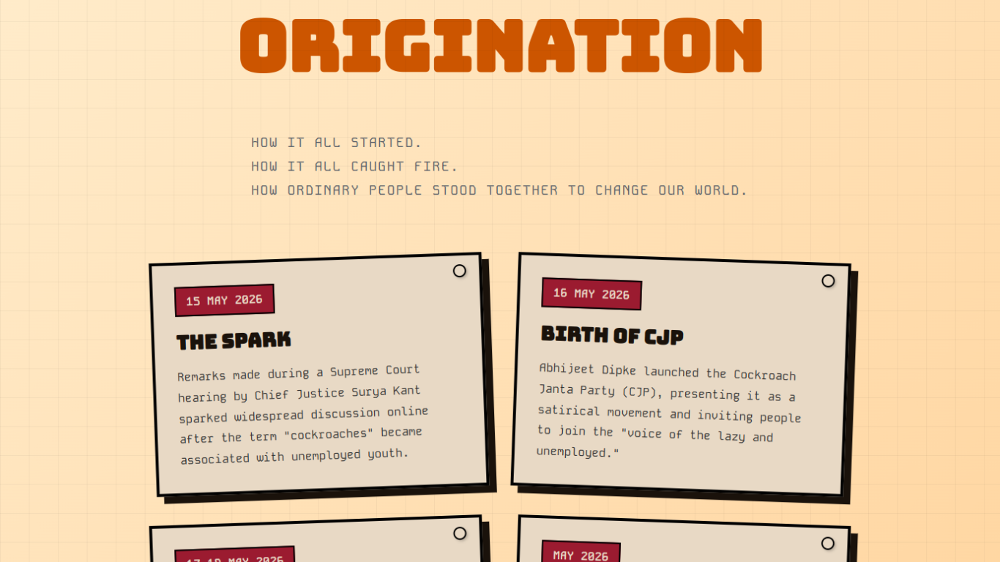
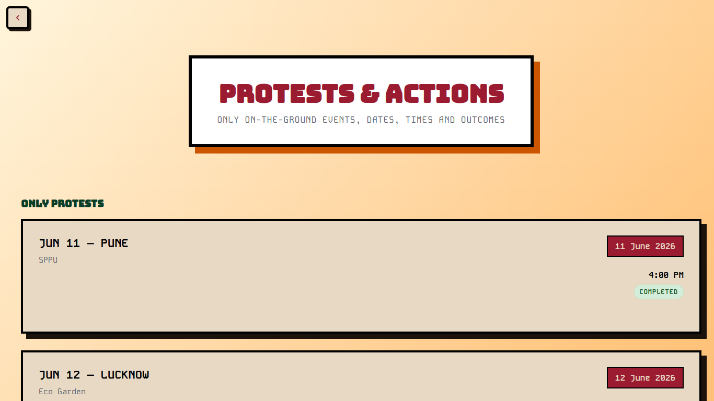

<div align="center">

# Cockroach Janta Party (CJP)

**Voice of the Lazy & Unemployed.**

A satirical political movement website archive inspired by the rapid rise of the Cockroach Janta Party (CJP), one of India's most talked-about internet-born youth movements.


Live Preview: https://cockroachjantaparty.senvor.dev/



</div>

---

## What is it?

This is a fan-made archive site for the Cockroach Janta Party. It tells the story of how the movement started, shows its manifesto, lists its on-the-ground protests and links out to the official site, petition and socials.

It's two pages:

- **Home** (`index.html`) - the landing section, origin story, manifesto and contact info
- **Protests** (`protest.html`) - the list of protests with dates, times, places and status

## Features

- **Paper-style design** inspired by the original website, with poster cards, a scrolling ribbon and a "Certified Cockroach" stamp
- **Three chapters**: Origination (a timeline from 15 May 2026), Manifesto (5 points) and Contact
- **Typewriter titles** - the chapter labels type themselves out when you scroll to them
- **Stamp animation** on the manifesto that shows up once it's in view
- **Protests page** with 7 completed protests across Pune, Lucknow, Amritsar, Hyderabad, Bangalore, Jaipur and Delhi
- **Official links**: join, volunteer, the official site and the petition to sack the education minister
- **Hidden easter egg** - click the logo 5 times to open a secret "Cockroach Dossier"
- **Responsive** layout for phones

<div align="center">
  
  <br/>
  <i>Chapter One: how it all started.</i>
</div>

<br/>

<div align="center">
  
  <br/>
  <i>The protests page.</i>
</div>

## How to Use

1. Open the live preview
2. Use **Origin**, **Manifesto** and **Contact** in the top bar to jump around
3. Hit **Upcoming Protests** to see the protests page
4. Try clicking the logo a few times...

## Getting Started

It's plain HTML, CSS and JavaScript, so there's nothing to install.

```
git clone https://github.com/Senvor/Cockroach-Janta-Party.git
cd Cockroach-Janta-Party
```

Then open `public/index.html` in your browser.

## How it's hosted

GitHub Pages, deployed by a GitHub Actions workflow that publishes the `public/` folder on every push to `main`, at [cockroachjantaparty.senvor.dev](https://cockroachjantaparty.senvor.dev/).

## Tech Stack

- **HTML** - the two pages
- **CSS** - the papery look, poster cards, ribbon and animations
- **JavaScript** - typewriter titles, the stamp animation and the easter egg
- **GitHub Pages + GitHub Actions** - hosting and deploys

## Project Structure

```
Cockroach-Janta-Party/
├── public/
│   ├── index.html     # landing page, origin, manifesto, contact
│   ├── protest.html   # protests page
│   ├── style.css      # all the styling
│   ├── script.js      # typewriter titles, stamp, easter egg
│   └── assets/        # logo, cockroach art, founder photo
├── screenshots/       # README screenshots
└── .github/workflows/pages.yml  # deploy to GitHub Pages
```

## Design Philosophy

Instead of feeling like a modern website, I tried making it feel more papery and aesthetic.

## Why I Built It

I wanted to start something, then this movement started and I supported it too, so I built this to show my support.

## What I Learned

- Advanced CSS layouts
- Responsive design techniques
- Visual storytelling through UI
- Some JavaScript

## Disclaimer

This project is an archive of the original CJP (Cockroach Janta Party) members and actions.

All trademarks, logos, names, and references belong to their respective owners.

## License

This project is licensed under the [MIT License](LICENSE).

## Author

Developed by Senvor.
